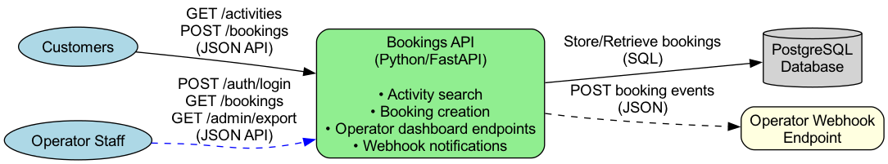

# DevSecOps Challenge


## Overview

This repository contains a booking API, plus the infrastructure code and pipelines used to deploy it. Operators list activities, customers book them, and operators are notified of new bookings. The `app` directory contains a README with details of the application.

This code has never been through a security review.

### Architecture

The application consists of two main components:

* **Bookings API** - A Python/FastAPI service handling activities, bookings and operator webhooks
* **PostgreSQL Database** - Stores operators, activities and bookings

#### Architecture Diagram



You can regenerate the diagram(with graphviz installed on your machine) using the following command:

```bash
dot -Tpng architecture.dot -o architecture.png
```

### Endpoints

**Bookings API**
- `POST /auth/login` - Staff login, returns a JWT (JSON)
- `GET /activities` - Public activity search (JSON)
- `POST /bookings` - Create a booking (JSON)
- `GET /bookings` - List bookings for the authenticated operator (JSON)
- `GET /bookings/{id}` - Fetch a single booking (JSON)
- `POST /bookings/{id}/cancel` - Cancel a booking (JSON)
- `GET /webhooks` - Read the operator's notification URL (JSON)
- `PUT /webhooks` - Set the operator's notification URL (JSON)
- `POST /webhooks/test` - Check that a URL is reachable from our side (JSON)
- `GET /admin/export` - CSV export of bookings
- `GET /healthz` - Health check endpoint (JSON)
- `GET /metrics` - Prometheus metrics

### Running it locally

```bash
docker compose up --build
```

The API is then available on `http://localhost:8000`. See `app/README.md` for seed accounts and tests.

## How to complete this challenge

**Limited AI usage**: Please refrain from relying solely on AI. It's fine to use it, but we just ask that the decisions are yours, since we will walk through your changes with you afterwards and talk about why you made them.

Your task is to review this repository for security problems, fix the ones that matter, and add or suggest automation that would stop them reaching production again. The submission should meet the following criteria:

1. **Prioritise**: Work within the time estimate at the end of this document. Fix what you think is important; we are more interested in how you solve the problems, and why, than in how many files you change.
2. **Keep it working**: `docker compose up` should still bring up a working API after your changes. `terraform validate` should still pass, and the Kubernetes manifests should still be valid.
3. **Stop it from happening again**: Fixing what is here is only half the job. Think about how problems like these could be caught before they reach production. How would you prevent them from happening again?
4. **You don't have to fix everything**: If you decide not to fix something, record that decision in a new .md file. How would you fix it, and how would you stop it happening again?
5. **Preserve the git history**: Keep this repository's commit history in your submission. Do not squash it, and do not start a fresh repository by copying the files across.

You do not need an AWS account, cloud credentials, or anywhere to deploy this. We will be reading your code, not a running system, so the Terraform and Kubernetes changes only need to be correct, not applied anywhere. You are also not expected to write exploits or produce a penetration test report.

## How to submit the challenge

1. **Create a Private Repository**: Create a new **private repository** in your own Github user. Do not use the Fork button, GitHub cannot make a private fork of a public repository.
2. **Commit your changes**: Clone this repository, point it at your own private repository, make your commits and push. Keep the commit history intact.
3. **Add Collaborators**: Invite the following GitHub users as collaborators:
   - `@bgroupe`
   - `@heruscode`
   - `@tleung999`
   - `@mustybatz`
   - `@arturocch`
   - `@lngauthier`

The estimated effort of this challenge is approximately 4 hours. Feel free to include any additional notes about how you would improve this as if it were your job to maintain it in a production environment, and how you would roll that out across a team that has no security tooling today. You can put those notes in the same .md file. Submit a link to your private repository.
